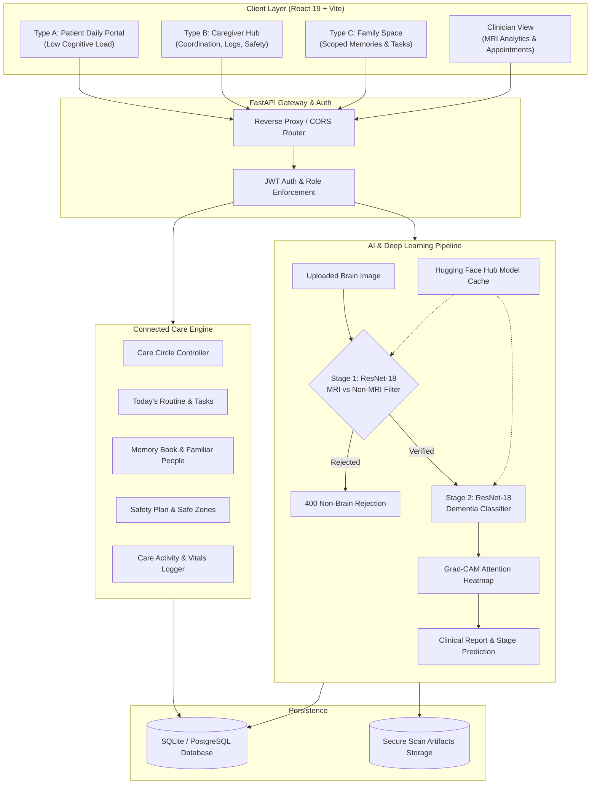

# 🧠 BrainTrace
> **AI-Powered Multi-Stage Neurocognitive Screening & Connected Dementia Care Platform**

[](https://fastapi.tiangolo.com/)
[](https://pytorch.org/)
[](https://react.dev/)
[](https://vitejs.dev/)
[](https://tailwindcss.com/)
[](https://huggingface.co/)
[](https://vercel.com/)
[](https://render.com/)

---

## 📌 Executive Summary

**BrainTrace** is an end-to-end medical AI platform engineered to tackle neurodegenerative cognitive decline and dementia. It combines **dual-stage deep learning validation (ResNet-18)** and **Grad-CAM explainable AI** with a **multi-user Connected Care Circle** architecture.

Instead of disconnected clinical tools, BrainTrace bridges the diagnostic and care journey across 4 distinct stakeholders:
1. **Persons Living with Dementia (User Type A):** Minimal-cognitive-load daily support view.
2. **Primary Caregivers (User Type B):** Coordination dashboard for routines, care logs, vitals, and safety planning.
3. **Authorized Family Members (User Type C):** Scoped access for memory book collaboration and task delegation without breaching clinical privacy.
4. **Neurologists & Clinicians:** Deep-learning MRI review, Grad-CAM attention heatmaps, and appointment consultations.

---

## 🏗️ System Architecture & Workflow



---

## 👥 Stakeholder Experiences (User Types)

### 4.1 User Type A: Person Living with Dementia
Designed specifically for cognitive accessibility:
- **Zero-Password Instant Access:** Low-friction entry avoiding password-induced disorientation.
- **Predictable Routine Checklist:** High-contrast, single-action completion buttons for medications, meals, and gentle exercise.
- **Familiar People & Memories:** Photo identification cards with context prompts (*"Your eldest daughter Priya who visits every Sunday"*).
- **1-Touch Emergency Assistance:** Direct one-click dialer and clear home address card.
- **Zero Medical Jargon:** Complex graphs, numbers, and diagnostic forms are intentionally isolated.

### 4.2 User Type B: Primary Caregiver
A comprehensive care orchestration dashboard:
- **Routine & Task Delegation:** Assign tasks to self, patient, or specific family members.
- **Care Activity & Vital Logger:** Real-time recording of Blood Pressure, Heart Rate, Mood, Meal intake, and hydration.
- **Safety & Emergency Plan:** Manage safe-zones, wandering risk levels, preferred hospitals, and calming music/photo strategies.
- **Family Coordination:** Generate secure invitation codes to invite family members with fine-grained permissions.
- **Caregiver Education Hub:** Curated micro-learning guides on sundowning management and burnout prevention.
- **Audit Logging:** Immutable audit trail of sensitive patient modifications.

### 4.3 User Type C: Additional Family Members
Scoped access ensuring privacy with active participation:
- **Role-Based Authorization:** Backend-enforced permissions (`can_manage_appointments`, `can_view_memory_book`, `can_edit_memory_book`, `can_log_care`).
- **Memory Book Collaboration:** Contribute family photos, voice memos, and historical notes.
- **Care Delegation:** Complete assigned family errands without accessing private medical records or clinician recordings.

### 4.4 Clinicians & Neurologists
- **Automated MRI Diagnostic Screening:** Rapid assessment of structural axial scans.
- **Explainable Grad-CAM Heatmaps:** Visual audit trails showing anatomical regions driving model predictions.
- **Telehealth & In-Person Appointment Manager:** Manage schedules and consultation notes.

---

## 🤖 Deep Learning Pipeline Specifications

| Pipeline Stage | Model Architecture | Function | Classes / Output | Source |
|---|---|---|---|---|
| **Stage 1: Validation** | ResNet-18 (Custom Head) | Rejects non-medical/invalid images | `MRI Brain Scan` vs `Non-MRI / Invalid` | Hugging Face: `epsrbtcs/model1_mri_vs_nonmri` |
| **Stage 2: Staging** | ResNet-18 (Trained Weights) | Predicts severity of cognitive decline | `NonDemented`, `VeryMildDemented`, `MildDemented`, `ModerateDemented` | Hugging Face: `epsrbtcs/model2_mri_classifier` |
| **Explainability** | PyTorch Grad-CAM | Visualizes convolutional activations | Color-mapped Jet Heatmap overlay over raw axial slice | Layer 4 feature activation |
| **Companion Chat** | Google Gemini 2.5 Flash | Voice & text companion guidance | Context-aware navigation and medical disclaimers | Google GenAI SDK |

---

## 🛠️ Technology Stack

```
Frontend:
├── Framework: React 19 (TypeScript)
├── Build Tool: Vite 6
├── Styling: Tailwind CSS v4
├── Icons: Lucide React
├── Maps: @vis.gl/react-google-maps
└── Animations: Motion (Framer Motion)

Backend:
├── API Engine: FastAPI (ASGI)
├── Machine Learning: PyTorch 2.x, TorchVision, Grad-CAM
├── Image Processing: Pillow, NumPy, OpenCV-headless
├── Database & ORM: SQLAlchemy + SQLite (PostgreSQL compatible)
├── Security & Auth: PyJWT, Bcrypt, HTTPBearer
└── AI Integration: Google GenAI SDK & Hugging Face Hub Client

Infrastructure & Deployment:
├── Frontend Hosting: Vercel (Edge Network + SPA rewrites)
├── Backend Hosting: Render (Python 3 Linux Web Service)
└── Model Checkpoint Caching: Hugging Face Model Repositories
```

---

## 🔑 Demo Evaluation Credentials

The database is pre-seeded with baseline clinical fixtures for instant evaluation:

| User Type | Email | Password | OTP (if applicable) | Features to Evaluate |
|---|---|---|---|---|
| **Patient (Type A)** | `patient@demenx.ai` | *(Blank or any)* | None | Today's Routine, Familiar People, 1-Touch Help |
| **Caregiver (Type B)** | `caretaker@demenx.ai` | `caretaker123` | `123456` | Connected Care Hub, Activity Logger, Safety Plan, Invites |
| **Family (Type C)** | `family@demenx.ai` | `family123` | `123456` | Scoped Memory Book, Assigned Tasks, Restricted Medical Views |
| **Doctor / Clinician** | `doctor@demenx.ai` | `doctor123` | `123456` | MRI Upload & Grad-CAM Analysis, Appointments, Cognitive Reports |

---

## 🚀 Local Development Setup

### Prerequisites
- Python 3.10+
- Node.js 18+ and npm
- Git

### 1. Backend Setup
```powershell
# Navigate to backend directory
cd backend

# Create and activate virtual environment
python -m venv venv
.\venv\Scripts\Activate.ps1    # On Windows
# source venv/bin/activate     # On Linux / Mac

# Install dependencies
pip install -r requirements.txt

# Run backend development server
uvicorn main:app --host 127.0.0.1 --port 8000 --reload
```
*Backend runs on `http://127.0.0.1:8000` with interactive Swagger docs at `http://127.0.0.1:8000/docs`.*

### 2. Frontend Setup
```powershell
# Open new terminal and navigate to Frontend directory
cd Frontend

# Install npm dependencies
npm install

# Start Vite development server
npm run dev
```
*Frontend runs on `http://localhost:3000` with live API proxying.*

### 3. Run Automated Test Suite
```powershell
cd backend
python -m pytest tests/test_api.py -v
```
*(All 38 integration tests covering auth, deep learning models, care space authorization, and security checks must pass.)*

---

## 🌐 Production Deployment Guide

### A. Deploy Backend to Render
1. Create a **New Web Service** connected to your GitHub repository.
2. Set configuration:
   - **Root Directory:** `backend`
   - **Build Command:** `pip install -r requirements.txt`
   - **Start Command:** `uvicorn main:app --host 0.0.0.0 --port $PORT`
3. Add Environment Variables:
   - `ENVIRONMENT` = `demo`
   - `SEED_DEMO_DATA` = `true`
   - `JWT_SECRET_KEY` = `demenx-secure-dev-secret-key-32chars-min-change-in-prod`
   - `GEMINI_API_KEY` = *(Your Google Gemini API Key)*
4. Copy the assigned URL (e.g., `https://braintrace-backend.onrender.com`).

### B. Deploy Frontend to Vercel
1. Import repository on [vercel.com](https://vercel.com).
2. Set **Root Directory** to `Frontend`.
3. Add Environment Variable:
   - `VITE_API_BASE_URL` = `https://braintrace-backend.onrender.com` *(Without trailing slash)*
4. Click **Deploy**. Vercel will build the SPA and apply rewrite routes automatically via `vercel.json`.

---

## 🔒 Security & Privacy Architecture

- **Backend Enforcement:** Relationship scoping and authorization rules are enforced strictly at the database and dependency injection level, not client-side UI toggles.
- **Medical Record Scoping:** Family members can never view diagnostic reports or confidential neurologist recordings unless explicitly granted administrator privileges.
- **Audit Logging:** Every sensitive modification (safety plans, member permission changes, routine additions) logs an immutable audit event (`CareSpaceAuditLog`).
- **HIPAA / GDPR Ready Principle:** Minimal cognitive burden for the patient without compromising personal dignity or autonomous agency.

---

## 📄 License
This project is developed for hackathon evaluation and neurocognitive healthcare innovation. Licensed under the MIT License.
